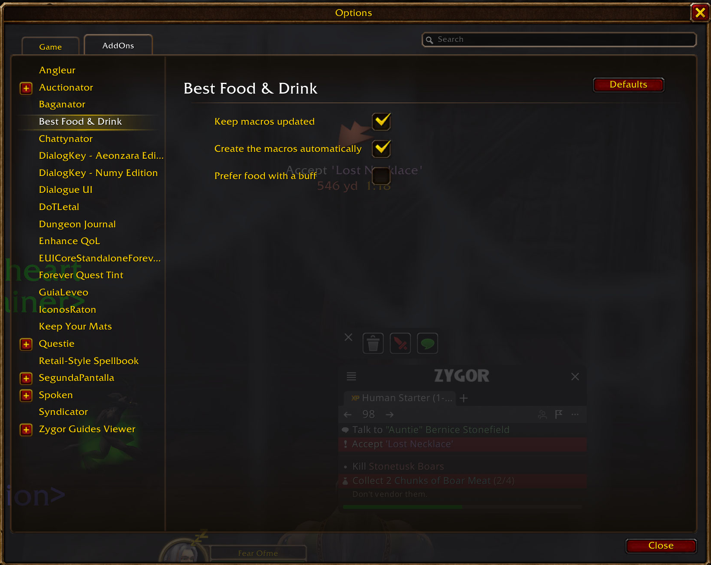

# Best Food & Drink

Addon para World of Warcraft: Forever. Te da dos macros de personaje, **MejorComida** y **MejorBebida**
(BestFood y BestDrink con el cliente en inglés), que usan siempre la mejor comida y la mejor bebida que
llevas en las bolsas. Se reescriben solas, fuera de combate, cada vez que cambian tus bolsas o subes de
nivel.

## Qué es «la mejor»

Entre la comida (o bebida) que tu nivel permite usar:

1. Si la opción «Preferir comida con bonus» está desactivada (por defecto), la que da *Bien alimentado*
   solo se usa cuando no tienes otra; activada, va primero.
2. La que más restaura (el número del tooltip: «Restaura 243 p. de salud…»).
3. A igualdad, la de mayor nivel requerido.
4. A igualdad, el objeto del que tienes menos (libera huecos antes).
5. De ese objeto, la **pila más pequeña**: la macro hace `/use bolsa hueco` de esa pila.

Los refrigerios que restauran salud y maná a la vez cuentan para las dos macros. Pociones, vendas y
demás consumibles se ignoran.

## Por qué macros y no botones propios

Una macro se arrastra a cualquier barra (la de Blizzard o la de otro addon), enseña icono, número y
reutilización sin código extra y se le pone atajo como a cualquier botón. Su único límite es que no se
puede editar en combate, pero en combate tampoco se puede comer ni beber, así que el addon la pone al
día al salir del combate.

## Uso

- Al entrar con cada personaje por primera vez, el addon crea las dos macros de personaje y lo dice en
  el chat. Ábrelas con `/macro` (pestaña del personaje) y arrástralas a tus barras.
- `/bfd` muestra qué va a usar cada macro ahora mismo.
- `/bfd crear` vuelve a crear las macros si las borraste (si las borras, no vuelven solas).
- `/bfd opciones` (o el compartimento de addons junto al minimapa) abre las opciones: mantener al día,
  crear solas y preferir comida con bonus.
- `/bfd debug` imprime el diagnóstico con los candidatos encontrados en las bolsas.
- `/bestfooddrink` es un alias de `/bfd`.

## Prueba en el cliente (pendiente)

Nada de esto se ha probado todavía en el cliente de Forever. Pasos:

1. Reinicia el cliente (primer arranque con un addon nuevo) y comprueba en la lista de addons que
   «Best Food & Drink» está activo. Entra con Fear Ofme.
2. En el chat debe salir «creadas las macros de personaje MejorComida y MejorBebida». Abre `/macro`,
   pestaña del personaje: tienen que estar las dos. Arrástralas a una barra.
3. Escribe `/bfd`: debe nombrar tu comida y bebida y lo que restauran. `/bfd debug` debe listar cada
   candidato con `restaura=` un número (si sale `nil`, el tooltip en español no se está leyendo bien) y
   `FoodSpell=Comida DrinkSpell=Bebida`.
4. Pasa el ratón por las macros de la barra: el tooltip y el icono deben ser los del objeto.
   Si el icono sale como interrogación, `#showtooltip item:ID` no funciona en Forever: avísalo.
5. Pulsa la macro de comida fuera de combate: debe comer de la pila más pequeña.
6. Compra o saquea una comida mejor (o tira la actual): en menos de un segundo la macro debe cambiar.
7. Entra en combate, cambia algo de las bolsas y sal: la macro se pone al día al salir, sin errores de
   «acción bloqueada» en BugSack.
8. Sin comida en las bolsas, pulsar la macro debe escribir «no llevas comida que puedas usar».

## Informar de un problema

El texto de `/bfd debug` y, si hay error, la exportación de BugSack.

## Desarrollo

Proyecto creado con la plantilla de la skill `wow-addons`. Comprobaciones fuera del juego (luacheck,
StyLua, LuaLS, API real de Forever, tests en Lua 5.1 y XML):

```powershell
C:\Users\Nico\.claude\skills\wow-addons\scripts\verificar-addon.ps1 -Carpeta .
```

- La lógica de elección es pura y está en `Modules/Picker.lua` (`tests/picker_spec.lua`).
- La lectura de bolsas, tooltips y la gestión de macros, en `Modules/Macros.lua`
  (`tests/macros_spec.lua`, con bolsas, objetos y macros simulados en `tests/support/fake_game.lua`).

## Licencia

MIT (ver `LICENSE`).

## Capturas


